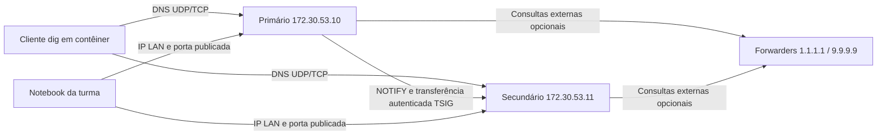

# Tutorial DNS — BIND 9

Proposta local para a [issue #2 — Tutorial DNS - Bind 9](https://github.com/joaoepj2/sistemas-distribuidos-tempo-real/issues/2).
Autor inicial: [guiguichinelo](https://github.com/guiguichinelo), RA 5157832.
Os demais integrantes e a revisão cruzada devem ser registrados antes da entrega.

**Estado:** arquivos de laboratório e testes preparados; execução Docker,
consumo medido, ensaio e validação por outro grupo ainda pendentes. As saídas
abaixo são critérios esperados, não resultados de uma execução certificada.
Veja o [registro de validação](validacao.md) para os checks locais concluídos.

## 1. Visão geral

BIND significa *Berkeley Internet Name Domain*. Surgiu no contexto do DNS em
Berkeley, na década de 1980. BIND 9 é uma reimplementação lançada em 2000,
mantida pela Internet Systems Consortium (ISC). Ela pode servir zonas
autoritativas, resolver consultas recursivamente e manter cache.

O DNS associa nomes a informações como endereços e localização de serviços.
Neste laboratório, o primário administra `lab.test`; o secundário recebe uma
cópia por transferência autenticada e continua respondendo se o primário cair.
Uma consulta externa pode ser encaminhada a resolvedores públicos e armazenada
em cache. A parte autoritativa local funciona sem internet após baixar as imagens.



Alternativas incluem NSD e Knot DNS para autoridade, Unbound para resolução
recursiva e CoreDNS para composição por plugins. Para um domínio público de
produção, este laboratório local não substitui delegação, DNSSEC, servidores
em domínios de falha diferentes e política de acesso adequada.

## 2. Conceitos mínimos

| Termo | Significado neste laboratório |
| --- | --- |
| Zona | Parte do espaço de nomes administrada em conjunto: `lab.test` |
| Autoritativo | Servidor que responde com dados da zona sob sua responsabilidade; flag `aa` |
| Primário/secundário | Origem administrativa e cópia replicada da zona |
| SOA e serial | Metadados da zona e número usado para identificar uma versão mais nova |
| A, CNAME e SRV | Endereço IPv4, alias e descoberta de serviço/porta |
| TTL e cache | Tempo pelo qual uma resposta pode ser reutilizada por um resolvedor |
| AXFR/IXFR e NOTIFY | Transferência completa/incremental e aviso de alteração da zona |
| TSIG | Autenticação de mensagens DNS com chave compartilhada; não criptografa o tráfego |

## 3. Pré-requisitos

- Git, Docker com contêineres Linux e Compose >= 2.20; nenhum pacote DNS no host.
- Windows: Docker Desktop/WSL2; Linux: Engine + Compose; macOS: Docker Desktop.
- Imagens AMD64 e ARM64: BIND da Canonical `9.20-26.04_stable` e cliente
  Netshoot `v0.14`, ambas fixadas pelo digest multiarch no Compose.
- Orçamento inicial: 1 GiB de RAM e 2 GiB de disco livres, além do runtime.
  Limites por contêiner: 192 MiB para cada DNS e 128 MiB para o cliente.
  Esses limites não são medições; use `docker stats --no-stream` no ensaio.
- Sub-rede Docker `172.30.53.0/24` livre de conflito com VPN e outras redes.

| Porta no host | Contêiner | Protocolo | Uso |
| --- | --- | --- | --- |
| 127.0.0.1:1053 | primário:53 | UDP e TCP | Consultar primário |
| 127.0.0.1:2053 | secundário:53 | UDP e TCP | Consultar secundário |
| Não publicada | ambos:953 | TCP | Controle RNDC apenas no loopback interno |

Data de preparação e consulta dos manifests: **14/10/2026**. Teste real em
Windows, Linux, macOS e revisão cruzada: **pendentes**. A arquitetura é
selecionada pelo Docker; não há `platform: linux/amd64` forçando emulação.

## 4. Instalação

Na pasta `tutoriais/dns/bind9/`:

```text
docker version
docker compose version
docker compose config --quiet
docker compose --profile ferramentas pull
docker compose up -d
docker compose ps
```

O `pull` inclui o cliente opcional para não depender da internet na sala.
O `up` inicia somente os dois DNS; o cliente é temporário e roda sob demanda.
Espere ambos aparecerem como `healthy`. Para aguardar automaticamente:

```text
docker compose up -d --wait --wait-timeout 120
docker compose run --rm --no-deps cliente sh /testes/verificar.sh normal
```

Resultado esperado: linhas `OK` para os dois servidores e para SOA/AXFR.
O teste espera a zona inicial chegar ao secundário; RNDC saudável por si só
confirma o processo ativo, não a conclusão da replicação.

O arquivo da raiz inclui este Compose. Você pode trabalhar da raiz, mas use
sempre a mesma pasta e o mesmo nome de projeto; os padrões de nomes variam
por pasta. A variável `-p` permite escolher um nome explícito.

## 5. Configuração

| Arquivo | Função |
| --- | --- |
| `docker-compose.yml` | Rede, dois servidores, cliente opcional, portas, limites e volumes |
| `config/primario/named.conf` | Zona primária, permissão de transferência TSIG e NOTIFY |
| `config/secundario/named.conf` | Origem da transferência, chave e destino persistente da cópia |
| `config/shared/options.conf` | Escuta, cache, forwarders e controle RNDC |
| `config/shared/lab.key` | Chave pública de estudo, compartilhada entre os nós |
| `config/shared/rndc.conf` | Cliente de controle do BIND usado pelo healthcheck |
| `zones/db.lab.test` | Zona primária, editável no host e montada somente para leitura |

A imagem Canonical 9.20 foi escolhida por oferecer variantes nativas AMD64 e
ARM64. Seu entrypoint Pebble foi substituído pelo binário `named -g`, para logs
no Docker e configuração direta. No laboratório ele roda como UID 0 dentro
do contêiner para criar arquivos nos volumes, sem `privileged`, rede do host
ou montagens graváveis do código. O parâmetro `-n 2` limita o número de workers
para evitar criar threads proporcionalmente a todos os núcleos do host.

O domínio usa `.test`, reservado para testes; `.local` pode conflitar com mDNS.
Os endereços `192.0.2.80/81` são fictícios (TEST-NET): consultar um A não significa
que existe um servidor HTTP nesses endereços. Os NS usam os IPs da rede Docker.

A chave TSIG versionada é **fictícia, pública e exclusiva de laboratório**.
Ela autentica transferências e o controle local RNDC; não oferece sigilo.
O cliente de testes não monta essa chave e deve ter seu AXFR recusado.
Há quatro volumes nomeados: cache e dados de cada servidor. O secundário grava
a zona recebida em `/var/lib/bind`, permitindo reinício sem o primário.

O `.env` é opcional e muda somente endereço/portas publicados. Para liberar
consultas dos colegas, use `DNS_BIND_ADDRESS=0.0.0.0`, recrie com
`docker compose up -d` e libere 1053/2053 TCP/UDP no firewall da rede de aula.
Compartilhe seu IP LAN; não os IPs Docker. A recursão deste laboratório permite
os clientes que alcançam o serviço; use somente uma rede de aula confiável e
retorne ao loopback depois. Não configure o DNS do sistema para essas portas.

Se a sub-rede conflitar, altere o subnet e os dois IPs no Compose, os endereços
em `also-notify`/`primaries`, os A de `ns1`/`ns2` e o IP do teste de falha.
Incremente o serial e recrie o ambiente. Apenas mudar `-p` não resolve conflito
de sub-rede entre instâncias simultâneas.

## 6. Demonstração

Siga [roteiro-demo.md](roteiro-demo.md), com 3 minutos para iniciar, 7 para
consultas e participação da turma e 5 para queda e recuperação do primário.

Consultas executadas no contêiner cliente, iguais em todos os hosts:

```text
docker compose run --rm --no-deps cliente dig @dns-primario app.lab.test A
docker compose run --rm --no-deps cliente dig @dns-primario www.lab.test CNAME +short
docker compose run --rm --no-deps cliente dig @dns-primario _http._tcp.lab.test SRV +short
docker compose run --rm --no-deps cliente dig @dns-secundario lab.test SOA +short
```

Espere `192.0.2.80` e flag `aa` no A; `app.lab.test.` no CNAME;
`0 5 8080 app.lab.test.` no SRV; o mesmo SOA/serial nos dois DNS.

De um notebook Linux/macOS com `dig` disponível, substitua `IP_DO_APRESENTADOR`:

```text
dig @IP_DO_APRESENTADOR -p 1053 app.lab.test A
dig @IP_DO_APRESENTADOR -p 2053 app.lab.test A
```

No PowerShell, sem instalar `dig`, a consulta com porta alta pode ser feita
usando o cliente Docker (substitua o IP):

```text
docker compose run --rm --no-deps cliente dig @IP_DO_APRESENTADOR -p 1053 app.lab.test A
```

### Autoridade, encaminhamento e cache (com internet)

```text
docker compose exec dns-primario rndc -c /etc/bind/shared/rndc.conf flushname example.org
docker compose run --rm --no-deps cliente dig @dns-primario example.org A +noall +answer +comments
docker compose run --rm --no-deps cliente sleep 5
docker compose run --rm --no-deps cliente dig @dns-primario example.org A +noall +answer +comments
```

A resposta externa deve ter `ra` e não `aa`; o TTL da resposta em cache tende
a diminuir entre consultas. Prefetch, TTL muito curto e alterações no upstream
podem afetar a observação; tempo de resposta isolado não prova cache.
Se a rede bloquear os forwarders, registre o erro e prossiga com a zona local.

### Alterar uma versão de zona

Edite `api` para `192.0.2.82` em `zones/db.lab.test` e incremente o serial para
`2026101402`. Valide e recarregue:

```text
docker compose exec dns-primario named-checkzone lab.test /etc/bind/zones/db.lab.test
docker compose exec dns-primario rndc -c /etc/bind/shared/rndc.conf reload lab.test
docker compose run --rm --no-deps cliente dig @dns-secundario api.lab.test A +short
```

Após o NOTIFY e a transferência, espere `192.0.2.82` no secundário. A transferência
é assíncrona; repita a consulta se necessário. Consultas diretas autoritativas
não aguardam o TTL do cache de outro resolvedor. Ao desfazer a alteração,
incremente novamente o serial, sem voltar a uma versão menor.

## 7. Verificação e teste de falhas

Valide os arquivos usando os próprios binários BIND, antes de iniciar:

```text
docker compose run --rm --no-deps --entrypoint named-checkconf dns-primario -z /etc/bind/named.conf
docker compose run --rm --no-deps --entrypoint named-checkconf dns-secundario /etc/bind/named.conf
docker compose run --rm --no-deps --entrypoint named-checkzone dns-primario lab.test /etc/bind/zones/db.lab.test
```

Espere código zero e `OK` na validação da zona. O teste funcional verifica A
por UDP/TCP, CNAME, SRV, NS, NXDOMAIN autoritativo, igualdade de SOA e recusa
de AXFR sem chave. O primário deve cair somente após esse teste passar.

```text
docker compose run --rm --no-deps cliente sh /testes/verificar.sh normal
docker compose stop dns-primario
docker compose run --rm --no-deps cliente sh /testes/verificar.sh falha
```

Espere falha ao consultar o IP do primário e respostas corretas do secundário.
Para verificar persistência, recrie somente o secundário, com o primário parado:

```text
docker compose up -d --no-deps --force-recreate --wait --wait-timeout 120 dns-secundario
docker compose run --rm --no-deps cliente sh /testes/verificar.sh falha
docker compose up -d --wait --wait-timeout 120
docker compose run --rm --no-deps cliente sh /testes/verificar.sh normal
```

O secundário serve sua cópia até o prazo `expire` de 3600 segundos. Ele não vira
primário nem aceita alterações administrativas automaticamente. Consultar
explicitamente o secundário demonstra disponibilidade da réplica, não uma
troca automática do DNS configurado no sistema do cliente.

Execute ainda a limpeza da próxima seção e suba do zero; a zona deve voltar a
ser transferida. Testes de consulta externa são opcionais e dependem de internet.
Registre resultados reais e consumo com `docker compose logs` e `docker stats`.

## 8. Problemas comuns

Incidentes desta preparação: Docker não encontrado no Windows local e serviço
WSL desativado. A execução está pendente até disponibilizar um runtime; nenhum
runtime foi instalado. A imagem atual da ISC consultada só oferecia AMD64,
motivando a seleção da imagem multiarch Canonical.

Os cenários abaixo são diagnósticos previstos, ainda não incidentes reproduzidos:

| Sintoma | Verificação e correção |
| --- | --- |
| `include` não reconhecido | Atualize Compose para >= 2.20 |
| Porta ocupada | Ajuste as portas no `.env` da pasta usada e recrie os serviços |
| Sub-rede sobreposta | Ajuste rede, IPs, configurações, zona e teste conforme seção 5 |
| `healthy`, mas zona não responde | Aguarde transferência e confira logs do secundário; teste funcional verifica a zona |
| Secundário não atualiza | Confira serial crescente, TSIG, NOTIFY e conectividade TCP/UDP 53 interna |
| SERVFAIL externo | Confira acesso aos forwarders, relógio do host e validação DNSSEC; a zona local continua demonstrável |
| Erro de leitura da montagem | Confira compartilhamento da pasta no Desktop e permissões/SELinux no Linux |
| Colega não alcança o DNS | Confira IP LAN, bind address, firewall e isolamento de clientes do Wi-Fi |
| Parece haver dois laboratórios | Confira a pasta e o nome de projeto `-p` usados nos comandos |

## 9. Limpeza

Na mesma pasta e com o mesmo `-p`, se usado, encerre preservando os dados:

```text
docker compose down --remove-orphans
```

Para apagar os quatro volumes de laboratório, incluindo a cópia do secundário:

```text
docker compose down --volumes --remove-orphans
```

Isso remove os contêineres e a rede do projeto. Não apaga configurações
versionadas nem imagens baixadas. A próxima subida inicializa os volumes do zero.
Reverta manualmente mudanças de demonstração na zona com serial crescente,
e desfaça liberações de firewall/escuta externa feitas para a turma.

## 10. Referências

- [Issue #2 do professor](https://github.com/joaoepj2/sistemas-distribuidos-tempo-real/issues/2).
- [História do BIND, ISC](https://www.isc.org/bindhistory/).
- [Manual BIND 9.20: configuração e zonas](https://bind9.readthedocs.io/en/v9.20.16/chapter3.html).
- [Referência BIND 9.20: TSIG, transferências e opções](https://bind9.readthedocs.io/en/v9.20.16/reference.html).
- [Imagem Canonical BIND 9, tags e arquiteturas](https://hub.docker.com/r/ubuntu/bind9).
- [Fonte da imagem Canonical](https://github.com/canonical/bind9-rock).
- [Cliente Netshoot v0.14](https://github.com/nicolaka/netshoot/tree/v0.14).
- [Compose include](https://docs.docker.com/reference/compose-file/include/).
- [RFC 2606: domínios reservados](https://www.rfc-editor.org/rfc/rfc2606).
- [RFC 5737: endereços IPv4 para documentação](https://www.rfc-editor.org/rfc/rfc5737).

Referências consultadas em 14/10/2026. Manual da série 9.20; revisão 9.20.16
consultada para a sintaxe. A imagem é fixada por digest; confirme a versão de
patch efetiva com `docker compose run --rm --no-deps --entrypoint named dns-primario -V`.
