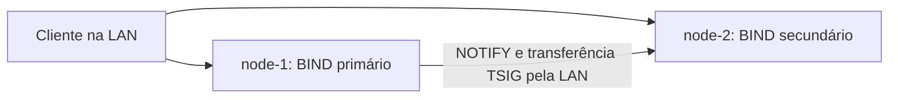

# BIND 9 em dois nós

## 1. Visão geral

DNS traduz nomes em endereços e permite descoberta de serviços. Neste laboratório,
o primário mantém a zona `lab.test`; o secundário recebe uma cópia por transferência
autenticada e continua respondendo quando a VM primária está desligada.
CoreDNS é uma alternativa; DNS não substitui um diretório de identidades nem
um mecanismo de consenso para dados de aplicação.



Cada VM tem uma interface, um IP e um MAC próprios na mesma rede. Cada execução
do Compose cria apenas um BIND. Duas VMs no mesmo host físico demonstram falha
de VM; para tolerar falha do host físico, distribua-as por hosts diferentes.

## 2. Conceitos mínimos

| Termo | Significado |
| --- | --- |
| Zona | Conjunto de registros administrado como unidade |
| Autoritativo | Servidor responsável pelos dados da zona |
| Primário | Origem das alterações da zona |
| Secundário | Cópia recebida pela rede, também autoritativa |
| SOA/serial | Metadados e versão da zona |
| AXFR/IXFR | Transferência completa/incremental |
| TSIG | Autenticação de mensagens entre servidores |
| Resolvedor | Cliente que procura respostas DNS |

## 3. Pré-requisitos

Duas máquinas com IPs distintos e estáveis, Docker e Compose >= 2.20.
Reserve cerca de 512 MiB de memória e 2 GiB de disco para o laboratório em cada
nó, além do sistema operacional. Imagens estão fixadas por tag e digest no
Compose. O usuário que executa os comandos precisa ter acesso ao Docker.
Para DHCP, configure reservas; mudança de IP exige atualizar os dois `.env`.

| Porta na LAN | Uso |
| --- | --- |
| 53/UDP | Consultas e NOTIFY |
| 53/TCP | Consultas TCP e transferência de zona |

Libere essas portas entre os nós e para os clientes autorizados. A publicação
fica vinculada ao IP LAN da VM, permitindo coexistir com resolvedor no loopback.
Se houver conflito, escolha a mesma porta alta nos dois `.env`, por exemplo
`DNS_PORT=1053`; clientes convencionais usam 53, e `dig` precisa de `-p 1053`.
Windows/macOS exigem Docker Desktop e validação do firewall local.

## 4. Instalação

Clone o fork em cada nó. Na raiz, copie `.env.example` para `.env` (`cp` no
Linux/macOS, `Copy-Item` no PowerShell). Edite com os endereços reais.
Os IPs abaixo são exemplos fictícios, não endereços para usar sem alteração:

| Variável | node-1 | node-2 |
| --- | --- | --- |
| BIND_ROLE | primario | secundario |
| DNS_PRIMARY_IP | 192.0.2.10 | 192.0.2.10 |
| DNS_SECONDARY_IP | 192.0.2.11 | 192.0.2.11 |
| DNS_BIND_ADDRESS | 192.0.2.10 | 192.0.2.11 |
| DNS_CLIENT_CIDR | 192.0.2.0/24 | 192.0.2.0/24 |
| DNS_PORT | 53 | 53 |

Execute em cada nó:

```sh
docker compose --profile ferramentas config --quiet
docker compose --profile ferramentas pull
docker compose up -d --wait --wait-timeout 120
docker compose ps -a
```

Resultado: um `dns` saudável e um `configurador` finalizado com código zero.
O secundário precisa alcançar o primário para obter a primeira cópia da zona;
a saúde do processo, sozinha, não comprova replicação. O teste abaixo comprova.
Também é possível executar na pasta deste tutorial, com seu próprio `.env`.

## 5. Configuração

`config/gerar-config.sh` valida o papel, IPs distintos e a correspondência do IP
local com o papel escolhido. Ele preenche os modelos em um volume, sem alterar
arquivos versionados. `config/primario/named.conf` habilita NOTIFY para o IP
LAN do secundário; `config/secundario/named.conf` recebe a zona pelo IP LAN do
primário. Não são utilizados nomes de serviços Docker para comunicação entre VMs.

`zones/db.lab.test` contém A, CNAME, SRV, SOA e NS. Os NS apontam aos IPs reais
informados no `.env`; os endereços de aplicação 192.0.2.80/81 são fictícios.
`config/shared/options.conf` limita consultas/recursão à rede configurada e às
redes locais do contêiner. Encaminhadores externos precisam de acesso à Internet;
a zona local funciona sem eles. Os volumes `cache` e `dados` preservam o estado
e a zona recebida. O secundário não monta uma cópia da zona primária.

A chave TSIG versionada é pública e exclusiva deste exercício. Para uso fora do
laboratório, gere outra chave e distribua-a por canal privado aos dois nós.
Após mudar registros, incremente o serial e recrie o serviço:

```sh
docker compose up -d --force-recreate --wait --wait-timeout 120
```

## 6. Demonstração

Siga o [roteiro de 15 minutos](roteiro-demo.md). Mostre hostname, IP e apenas um
BIND em cada VM. Consulte os dois servidores, compare o serial SOA e mostre
os logs da transferência. Explique que consultar diretamente o secundário
demonstra disponibilidade dos dados; a escolha automática de outro servidor
depende do resolvedor do cliente e de sua configuração.

## 7. Verificação e teste de falhas

Após iniciar os dois nós, em qualquer um execute:

```sh
docker compose run --rm --no-deps cliente sh /testes/verificar.sh normal
docker compose logs --tail=80 dns
```

O teste verifica A por UDP/TCP, CNAME, SRV, NS, resposta negativa autoritativa,
igualdade de serial, endereços NS e recusa de AXFR sem chave.
Desligue a VM primária pelo hipervisor, mantendo a VM secundária ligada.
No secundário:

```sh
docker compose run --rm --no-deps cliente sh /testes/verificar.sh falha
```

Espera-se ausência de resposta do primário e consultas bem-sucedidas ao
secundário. Religue a VM primária e repita `normal`. O secundário serve a cópia
até o prazo de expiração do SOA, não indefinidamente sem contato com o primário.
O [procedimento de verificação](validacao.md) detalha os comandos e resultados
esperados. A CI valida os papéis em runners separados; a comunicação entre nós
e os testes de falha precisam ser executados no laboratório distribuído.

## 8. Problemas comuns

| Sintoma | Correção |
| --- | --- |
| Variável obrigatória ausente | Criar `.env` na pasta onde executa o Compose |
| Porta ocupada ou IP indisponível | Usar IP pertencente à VM; conferir firewall e serviço na porta |
| Secundário saudável, mas SERVFAIL | Conferir IPs, TCP/UDP, chave e logs; esperar primeira transferência |
| Zona não atualiza | Incrementar serial e recriar; conferir NOTIFY e conexão ao primário |
| Erro de montagem somente leitura | Manter um volume completo em `/etc/bind`, sem montagens aninhadas |

## 9. Limpeza

Em cada VM, `docker compose down` preserva os volumes. Para descartar somente
os dados deste laboratório: `docker compose down --volumes --remove-orphans`.
O `.env` pode ser removido manualmente quando não for mais necessário.
Não execute `docker system prune` para limpar este projeto.

## 10. Referências

- [BIND 9 ARM, série 9.20](https://bind9.readthedocs.io/en/v9.20.16/)
- [Imagem Ubuntu BIND 9](https://hub.docker.com/r/ubuntu/bind9)
- [Docker Compose](https://docs.docker.com/compose/)
- [Publicação de portas Docker](https://docs.docker.com/engine/network/port-publishing/)

As versões de imagem e seus digests estão fixados no Compose do laboratório.
